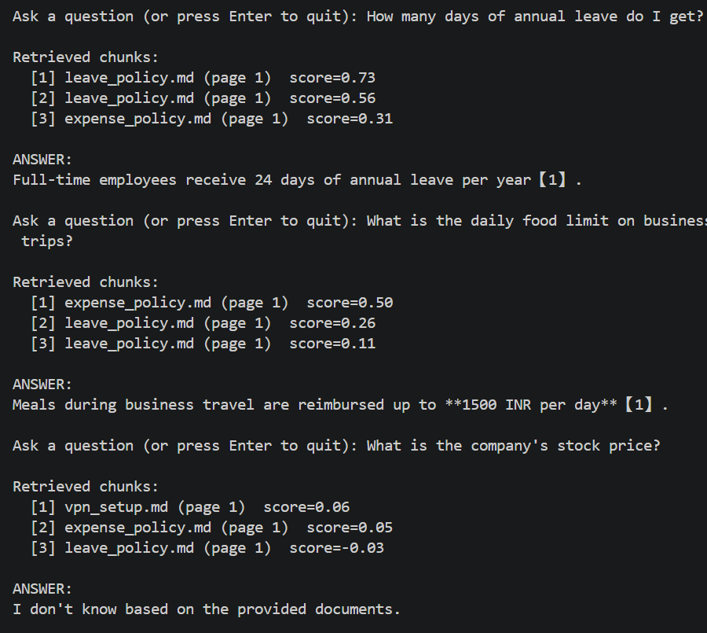

# rag-faiss-citations

A small Retrieval-Augmented Generation (RAG) assistant. It indexes documents with sentence-transformers and FAISS, retrieves the most relevant chunks for a question, and has an LLM (Groq) answer **only from those chunks, with numbered source citations**. If the answer is not in the documents, it says so.

**Skills shown:** RAG pipeline, chunking with overlap, embeddings (sentence-transformers), FAISS vector search, grounded answers with citations, retrieval evaluation against a keyword baseline.

## Pipeline

    documents -> chunks (80 words, 20 overlap) -> embeddings -> FAISS index
    question  -> embedding -> top-k chunks -> prompt -> LLM answer with [1] [2] citations

Each chunk stores its source file and page, which is what makes the citations possible.

## Files

- `rag.py`: loading, chunking, FAISS index, search, keyword baseline, answer generation
- `main.py`: ask questions in the terminal
- `eval.py`: compares keyword search with embedding search
- `docs/`: sample documents (made-up company policies)

## Setup

    python -m venv venv
    venv\Scripts\Activate.ps1        # Mac/Linux: source venv/bin/activate
    python -m pip install -r requirements.txt
    copy .env.example .env           # then add your Groq API key

The first run downloads the small embedding model (all-MiniLM-L6-v2). You can add your own `.txt`, `.md` or `.pdf` files to `docs/`.

## Run

    python main.py                   # interactive Q&A with citations
    python eval.py                   # retrieval evaluation (no API key needed)

## Evaluation (small demo, not a benchmark)

16 questions over 3 short documents (5 chunks), checking whether the right chunk is retrieved:

| Search | top-1 hit rate | top-3 hit rate |
|---|---|---|
| Keyword baseline | 12/16 (75%) | 16/16 |
| Embeddings + FAISS | 14/16 (88%) | 16/16 |

Embeddings helped most on paraphrased questions that share few words with the documents. The corpus is tiny, so top-3 is trivially perfect and the top-1 gap of 2 questions is only indicative. A larger corpus would be needed for a real comparison.

## Demo

